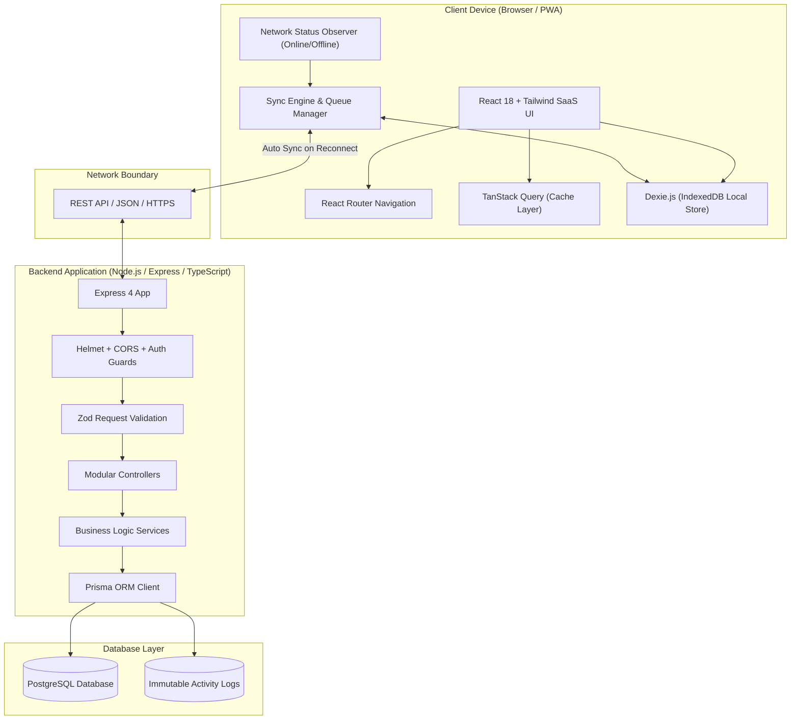
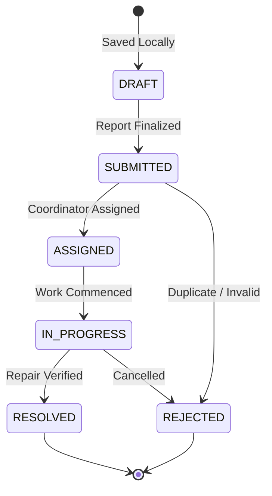
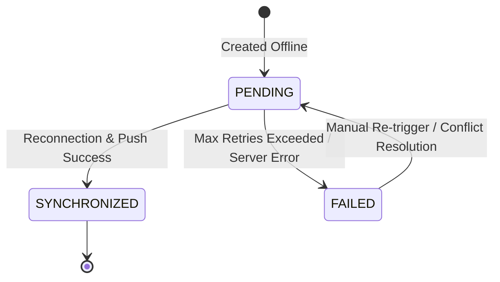

# FieldSync — Architecture & System Design Document

## 1. System Overview

**FieldSync** is an offline-first field issue reporting and management system engineered for field technicians, operations coordinators, and administrators in municipal and industrial infrastructure contexts (water points, electrical grids, public sanitation, mechanical equipment).

The system addresses the core challenge of reliable data collection in connectivity-constrained, low-bandwidth, and remote field environments.

---

## 2. High-Level Architecture Diagram



---

## 3. Core Design Principles

1. **Offline-First by Design**:
   - Reports, GPS markers, and drafts can be created and stored in the client-side IndexedDB database (via Dexie.js) when no internet connection is present.
   - Client records are assigned a client-generated UUID (`clientReportId`) so that retry requests and synchronization operations are idempotent and duplicate-proof.
2. **Clear Separation of Concerns**:
   - Dedicated monorepo workspace for frontend (`@fieldsync/frontend`) and backend (`@fieldsync/backend`).
   - Business logic is completely separated from UI components.
   - Centralized API request handling and standardized response payloads (`ApiResponse`).
3. **Type Safety & Data Integrity**:
   - Strict TypeScript configurations with zero implicit any.
   - Unified domain types between database schema, backend DTOs, and frontend state.
   - Strict Zod validation on incoming request bodies, queries, and parameters.
4. **Professional SaaS Design Language**:
   - Clean, light-theme palette featuring dark slate / navy for navigation and high-contrast typography, paired with restrained teal and blue accents.
   - Responsive layouts optimized for desktop management dashboards and field mobile devices.

---

## 4. Domain & Data Model

### 4.1 Workflow Status Lifecycle



### 4.2 Synchronization Status Lifecycle



---

## 5. Directory & Workspace Layout

```text
FieldSync/
├── frontend/                     # React + Vite client
│   ├── public/                   # Static assets & icons
│   ├── src/
│   │   ├── components/           # Common atomic design system
│   │   │   ├── common/           # Button, Card, Badge, StatusPill, EmptyState
│   │   │   └── layout/           # Sidebar, Header, Mobile navigation
│   │   ├── hooks/                # Custom React hooks (useNetworkStatus, etc.)
│   │   ├── layouts/              # AppLayout shell
│   │   ├── pages/                # Route views (Dashboard, Reports, Workflow, Sync, etc.)
│   │   ├── routes/               # Centralized React Router configuration
│   │   ├── services/             # API client, Dexie.js IndexedDB schema
│   │   ├── styles/               # Tailwind CSS entrypoint
│   │   ├── test/                 # React Testing Library & Vitest suites
│   │   ├── types/                # Frontend domain and state interfaces
│   │   ├── utils/                # Utility helpers (cn, formatters)
│   │   ├── App.tsx               # Root app with QueryClient & Router
│   │   └── main.tsx              # DOM mounting point
│   ├── index.html
│   ├── package.json
│   ├── tailwind.config.js
│   ├── tsconfig.json
│   ├── vite.config.ts
│   └── vitest.config.ts
│
├── backend/                      # Express + Prisma REST API
│   ├── prisma/
│   │   └── schema.prisma         # Prisma data models, enums & relations
│   ├── src/
│   │   ├── config/               # Environment & database connections
│   │   ├── controllers/          # HTTP request handlers (Health, etc.)
│   │   ├── middleware/           # Error handler, 404, logging, Zod validation
│   │   ├── routes/               # API route definitions & versioning
│   │   ├── services/             # Core business logic
│   │   ├── types/                # Express, DTO, and domain types
│   │   ├── utils/                # Logger, AppError, ApiResponse
│   │   ├── validators/           # Zod schemas for input validation
│   │   ├── app.ts                # Express application factory
│   │   └── server.ts             # Server entrypoint and graceful shutdown
│   ├── tests/                    # Vitest and Supertest integration tests
│   ├── package.json
│   ├── tsconfig.json
│   └── vitest.config.ts
│
├── docs/                         # System documentation
│   └── ARCHITECTURE.md
├── .env.example                  # Environment template
├── .gitignore                    # Git exclusions
├── eslint.config.mjs             # Modern unified ESLint 9 configuration
├── package.json                  # Monorepo workspaces orchestration
└── README.md                     # Setup, run, and development guide
```
