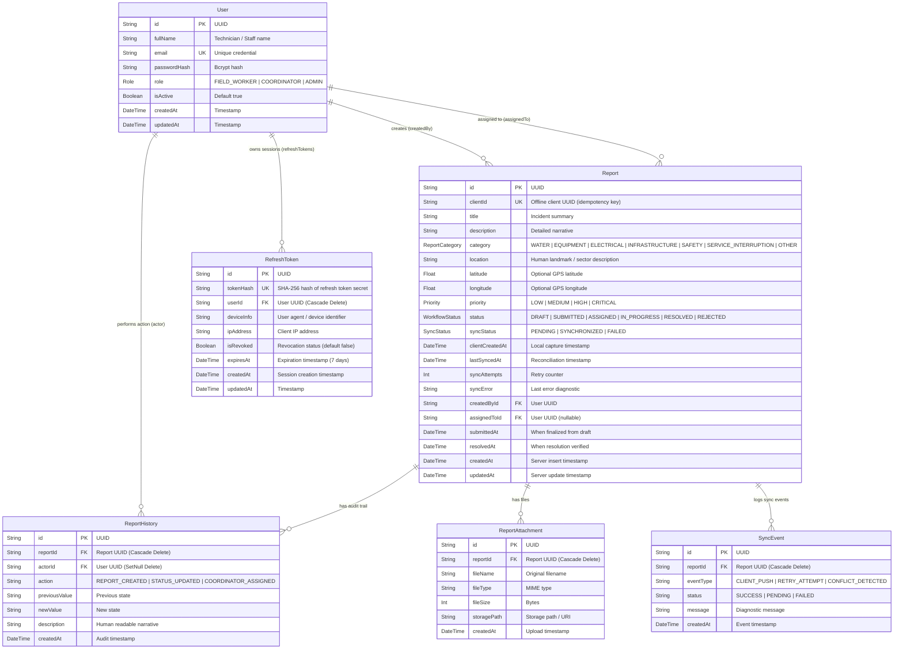
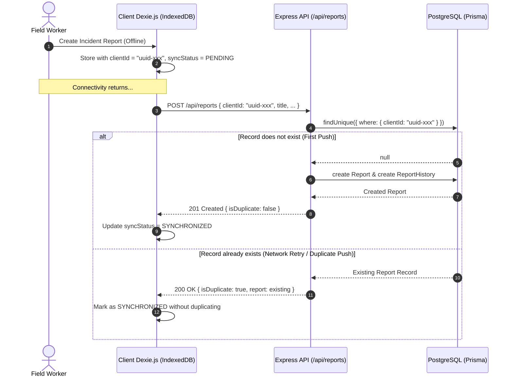

# FieldTrack — Database Architecture & Data Layer Specification

This document details the PostgreSQL relational schema, Prisma ORM models, relationships, indexing strategies, seed fixtures, and API contracts for **FieldTrack**.

---

## 1. Entity Relationship Diagram (ERD)



---

## 2. Models and Relationships Specification

### 2.1 `User` Model

Represents technicians, coordinators, and administrators within the system.

- **Indexes**: `role`, `email`.
- **Integrity**: `passwordHash` is never selected or transmitted over API endpoints.
- **Roles**:
  - `FIELD_WORKER`: Discovers and files infrastructure faults in the field.
  - `COORDINATOR`: Triages, assigns, and oversees technician execution.
  - `ADMIN`: Manages user accounts, regional zones, and system telemetry.

### 2.2 `Report` Model

The central domain model for infrastructure problems.

- **Client Idempotency Key (`clientId`)**: Unique UUID assigned at initial capture on client devices. Prevents duplicate report creation during offline retry cycles.
- **Indexes**: `status`, `priority`, `category`, `createdById`, `assignedToId`, `clientId`, `createdAt`.
- **Soft Deletion & Cascade Safety**: Associated `ReportHistory`, `ReportAttachment`, and `SyncEvent` records cascade when a report is deleted, but user references default to `onDelete: SetNull` or restrict deletion to prevent data loss.

### 2.3 `ReportHistory` (Audit Trail)

Append-only log recording every lifecycle milestone, status change, and coordinator assignment.

- **Actor Association**: Captures which user performed the mutation, with graceful handling if the actor account is deactivated (`onDelete: SetNull`).
- **Indexes**: `reportId`, `actorId`, `createdAt`.

### 2.4 `ReportAttachment` (Prepared Schema)

Stores metadata for future photo attachments, diagnostic logs, and schematics.

### 2.5 `SyncEvent` (Prepared Schema)

Captures granular push/reconciliation logs for monitoring sync health, conflicts, and offline queue throughput.

### 2.6 `RefreshToken` Model (Session Security & Token Rotation)

Stores session refresh credentials securely using deterministic SHA-256 hashes.

- **Hash Security (`tokenHash`)**: Raw refresh tokens are never persisted to the database. The database stores `SHA-256(rawRefreshToken)` so database compromise cannot leak usable session tokens.
- **Rotation on Refresh**: Every successful refresh revokes the presenting token and issues a new cryptographically bound refresh token.
- **Reuse Detection & Anti-Theft**: If a revoked refresh token is presented again (indicating token theft / replay attack), all active refresh tokens for that user are immediately revoked, terminating all sessions across all devices.
- **Cascade Deletion**: When a user is deleted, all their refresh tokens are cascade-deleted (`onDelete: Cascade`). When an administrator deactivates an account (`isActive: false`), all active sessions are immediately revoked.
- **Indexes**: `userId`, `tokenHash`.

---

## 3. Offline Idempotent Report Creation Strategy

When field workers lack connectivity, the client creates reports locally in IndexedDB (Dexie.js) with a client-generated UUID (`clientId`).



### Guarantees

1. **No Duplicates**: A re-sent payload with identical `clientId` returns the existing report with HTTP 200 and `{ meta: { isDuplicate: true } }`.
2. **No Silent Overwrites**: Existing report attributes are not modified during an initial create replay.
3. **Audit History**: Creation events record `REPORT_CREATED` in `report_history`.

---

## 4. API Specification & Examples

### 4.1 Health Check

**Endpoint**: `GET /api/health` (also available at `/health` and `/api/v1/health`)

#### Response (200 OK)

```json
{
  "success": true,
  "message": "FieldTrack API service health check",
  "data": {
    "status": "healthy",
    "timestamp": "2026-11-13T06:14:09.222Z",
    "uptime": 142.15,
    "environment": "development",
    "database": {
      "status": "connected",
      "message": "PostgreSQL connection operational"
    },
    "version": "0.1.0"
  }
}
```

---

### 4.2 Create Incident Report

**Endpoint**: `POST /api/reports`

#### Request Payload

```json
{
  "clientId": "550e8400-e29b-41d4-a716-446655440001",
  "title": "Substation Feeder Cable Insulation Deterioration",
  "description": "Thermal scan shows 94°C on terminal busbars under nominal load.",
  "category": "ELECTRICAL",
  "location": "North Municipal Substation Yard B",
  "latitude": -1.28543,
  "longitude": 36.82194,
  "priority": "HIGH",
  "status": "SUBMITTED"
}
```

#### Response (201 Created)

```json
{
  "success": true,
  "message": "Report created successfully",
  "data": {
    "id": "83a9825b-1b3f-4c0e-a0ec-5c2ac6fcb119",
    "clientId": "550e8400-e29b-41d4-a716-446655440001",
    "title": "Substation Feeder Cable Insulation Deterioration",
    "description": "Thermal scan shows 94°C on terminal busbars under nominal load.",
    "category": "ELECTRICAL",
    "location": "North Municipal Substation Yard B",
    "latitude": -1.28543,
    "longitude": 36.82194,
    "priority": "HIGH",
    "status": "SUBMITTED",
    "syncStatus": "SYNCHRONIZED",
    "createdById": "3f2e1a4b-...",
    "createdBy": {
      "id": "3f2e1a4b-...",
      "fullName": "Samuel Kiprop",
      "email": "samuel.kiprop@fieldtrack.local",
      "role": "FIELD_WORKER"
    },
    "createdAt": "2026-11-13T06:15:27.260Z",
    "updatedAt": "2026-11-13T06:15:27.260Z"
  },
  "meta": {
    "isDuplicate": false
  }
}
```

---

### 4.3 List Reports (Paginated & Filtered)

**Endpoint**: `GET /api/reports?category=WATER&priority=CRITICAL&page=1&limit=10`

#### Query Parameters

| Parameter  | Type    | Default | Description                                                                                     |
| :--------- | :------ | :------ | :---------------------------------------------------------------------------------------------- |
| `page`     | Integer | `1`     | Page number                                                                                     |
| `limit`    | Integer | `10`    | Records per page (max 100)                                                                      |
| `category` | Enum    | -       | `WATER`, `EQUIPMENT`, `ELECTRICAL`, `INFRASTRUCTURE`, `SAFETY`, `SERVICE_INTERRUPTION`, `OTHER` |
| `priority` | Enum    | -       | `LOW`, `MEDIUM`, `HIGH`, `CRITICAL`                                                             |
| `status`   | Enum    | -       | `DRAFT`, `SUBMITTED`, `ASSIGNED`, `IN_PROGRESS`, `RESOLVED`, `REJECTED`                         |
| `search`   | String  | -       | Full-text query on `title`, `description`, or `location`                                        |

#### Response (200 OK)

```json
{
  "success": true,
  "message": "Reports retrieved successfully",
  "data": [
    {
      "id": "550e8400-...",
      "title": "Borehole Submersible Pump Mechanical Seizure",
      "category": "WATER",
      "priority": "CRITICAL",
      "status": "IN_PROGRESS",
      "location": "Kibera District Sector 3 Borehole Well",
      "createdBy": {
        "fullName": "Amina Osei",
        "email": "amina.osei@fieldtrack.local",
        "role": "FIELD_WORKER"
      }
    }
  ],
  "meta": {
    "page": 1,
    "limit": 10,
    "total": 1,
    "totalPages": 1,
    "hasNextPage": false,
    "hasPrevPage": false
  }
}
```

---

### 4.4 Get Single Report by ID

**Endpoint**: `GET /api/reports/:id`

#### Response (200 OK)

```json
{
  "success": true,
  "message": "Report retrieved successfully",
  "data": {
    "id": "83a9825b-1b3f-4c0e-a0ec-5c2ac6fcb119",
    "title": "Borehole Submersible Pump Mechanical Seizure",
    "category": "WATER",
    "priority": "CRITICAL",
    "status": "IN_PROGRESS",
    "createdBy": {
      "fullName": "Amina Osei",
      "email": "amina.osei@fieldtrack.local"
    },
    "assignedTo": {
      "fullName": "Marcus Vance",
      "email": "marcus.vance@fieldtrack.local"
    },
    "history": [
      {
        "id": "hist-1",
        "action": "COORDINATOR_ASSIGNED",
        "description": "Assigned to coordinator for regional dispatch",
        "createdAt": "2026-11-12T07:45:00.000Z",
        "actor": {
          "fullName": "Marcus Vance"
        }
      },
      {
        "id": "hist-2",
        "action": "REPORT_CREATED",
        "description": "Incident report registered via offline client sync.",
        "createdAt": "2026-11-12T07:15:00.000Z",
        "actor": {
          "fullName": "Amina Osei"
        }
      }
    ],
    "attachments": []
  }
}
```

---

## 5. Seed Data & Credentials

Run database seeding via:

```bash
npm run db:seed
```

### Seed Fixtures Summary:

- **8 Users**:
  - `admin@fieldtrack.local` (Admin: Elena Rostova)
  - `marcus.vance@fieldtrack.local` (Coordinator: Marcus Vance)
  - `david.kimani@fieldtrack.local` (Coordinator: David Kimani)
  - `amina.osei@fieldtrack.local`, `samuel.kiprop@fieldtrack.local`, `grace.mwangi@fieldtrack.local`, `joseph.odhiambo@fieldtrack.local`, `faith.cherono@fieldtrack.local` (Field Workers)
- **16 Incident Reports**:
  - Spanning all 7 categories (`WATER`, `EQUIPMENT`, `ELECTRICAL`, `INFRASTRUCTURE`, `SAFETY`, `SERVICE_INTERRUPTION`, `OTHER`).
  - Spanning all 4 priorities (`LOW`, `MEDIUM`, `HIGH`, `CRITICAL`).
  - Spanning all 6 statuses (`DRAFT`, `SUBMITTED`, `ASSIGNED`, `IN_PROGRESS`, `RESOLVED`, `REJECTED`).
  - Rich audit history entries attached to reports.

_Default local password for demo users_: `Password123!`

---

## 6. Current Limitations & Next Steps

1. **Authentication / JWT Middleware**: Endpoints currently use user resolution fallback. Prompt 3 will introduce token-based authentication and route guards.
2. **File Storage**: The `ReportAttachment` model is prepared, but binary file uploads to S3/GCS will be introduced in a future prompt.
3. **Automated Background Sync Worker**: Prompt 9 will implement the dedicated background synchronization queue and conflict resolution rules.
